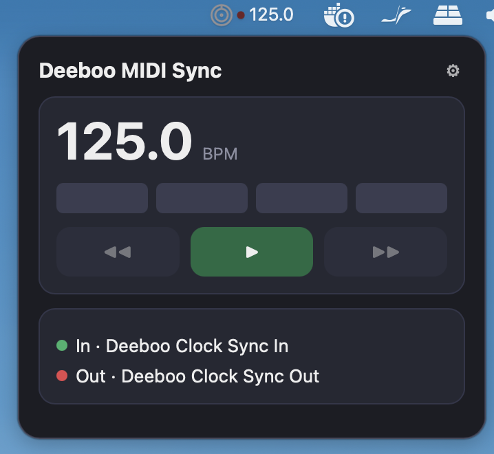
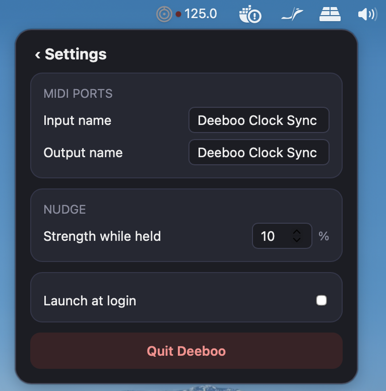

# Deeboo MIDI Sync

 

## What it is
A macOS menu bar app that relays MIDI clock from a master to a slave, with Play/Pause and a
hold-to-nudge "vinyl" push to line up phase by ear. It exposes two virtual ports, `Deeboo Clock Sync In` and
`Deeboo Clock Sync Out`, and shows the incoming BPM in the menu bar.

## Install
Download the `.dmg` from the GitHub Releases page. The app is ad-hoc signed (since 0.1.1) but not notarized, so macOS shows an "unidentified developer" warning the first time.
1. Open the DMG and drag the app to Applications.
2. Open it once. macOS blocks it and shows a warning: click **Done** (not "Move to Bin").
3. Open **System Settings → Privacy & Security** (or search "Security" in System Settings) and scroll down to the **Security** section.
4. Under "Allow applications from" you will see *"Deeboo MIDI Sync" was blocked to protect your Mac*. Click **Open Anyway**, then confirm with your password or Touch ID.
5. Open the app again and click **Open** in the last dialog. macOS remembers the choice; you only do this once per version.
6. Fallback: if macOS still says the app "is damaged", run:
   `xattr -dr com.apple.quarantine "/Applications/Deeboo MIDI Sync.app"`

## Usage
1. In your DJ software or DAW (the master), point the MIDI clock output at `Deeboo Clock Sync In`; the menu bar shows the BPM and a blinking dot: red blinking means clock is arriving, green blinking means Deeboo is sending it on (Play). A steady red dot means no input clock.
2. Point the slave's clock input at `Deeboo Clock Sync Out`.
3. Press Play on beat 1 of the phrase to start the slave. Hold `◀◀` or `▶▶` to nudge it slower or faster; release to return to 1:1.
4. Ports, nudge strength and launch at login are in Settings (⚙).

## Development
Everything except real MIDI and the DMG runs in Docker. Requires Docker, `just`, `lefthook`.
- `just precommit`: format check, lint and tests (also the git hook).
- `lefthook install`: enable the git hooks (run `just precommit` before each commit).
- `just dev`, `just dmg`, `just jitter`: macOS host only. The DMG lands in `target/release/bundle/dmg/`. If Finder styling fails in a non-GUI session, run `CI=true just dmg`.
- `just ship`: push and wait for CI.
- Releases: pushing a tag `vX.Y.Z` builds the DMG and attaches it to a GitHub Release.

Agent guidance: `AGENTS.md` and `.claude/skills/`. Design: `docs/superpowers/specs/`.

## Measuring jitter
`just jitter --seconds 30` (macOS) listens for MIDI clock and reports how steady it is: pulse count, mean, stddev and p99 |deviation| of the interval in microseconds, plus the implied BPM. It uses the receiver-side CoreMIDI timestamps.

- `--port-name NAME` (default `Deeboo Probe`): create a virtual destination; point the master clock's output at it (direct run).
- `--connect NAME`: connect to an existing MIDI source whose name contains NAME, e.g. `--connect "Deeboo Clock Sync Out"` (via-Deeboo run).

Procedure:
1. Direct: master output -> `Deeboo Probe`. Run the probe, record stddev.
2. Via Deeboo: master output -> `Deeboo Clock Sync In`, probe with `--connect "Deeboo Clock Sync Out"`. Record stddev.
3. Repeat both idle and while holding the ▶▶ nudge button.

Added jitter = stddev(via Deeboo) - stddev(direct). Target: under 1 ms (1000 us).

## License
GPL-3.0.
